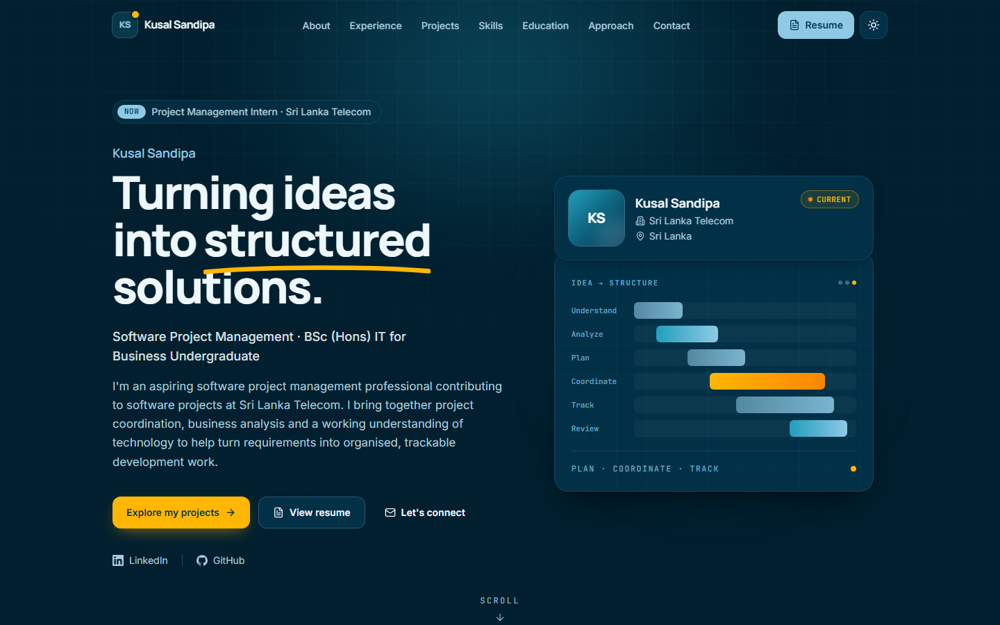
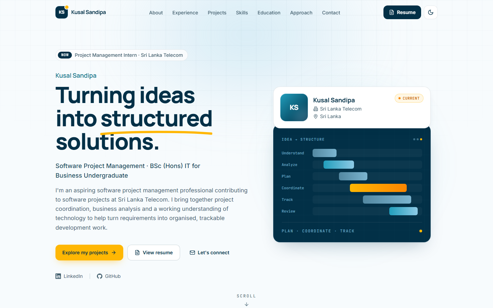
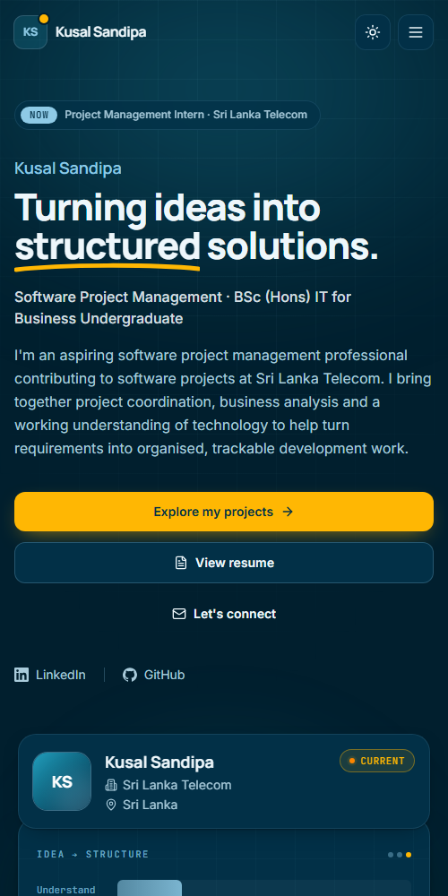
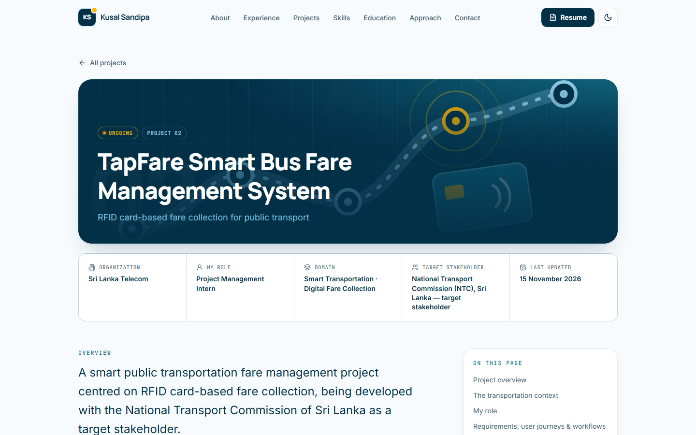
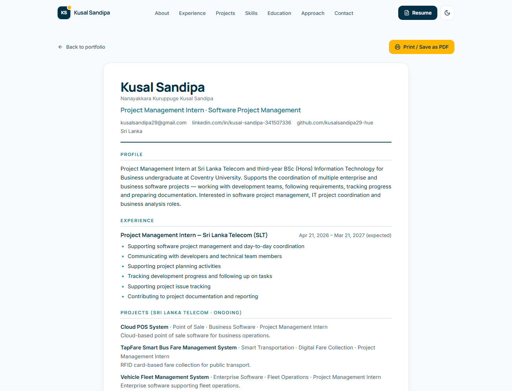

<div align="center">

# Kusal Sandipa — Professional Portfolio

**Software Project Management portfolio, digital CV and project case studies**

*Turning ideas into structured solutions.*

[](https://react.dev)
[](https://www.typescriptlang.org)
[](https://vite.dev)
[](https://tailwindcss.com)
[](https://motion.dev)

[LinkedIn](https://www.linkedin.com/in/kusal-sandipa-341507336) · [GitHub](https://github.com/kusalsandipa29-hue) · [Email](mailto:kusalsandipa29@gmail.com)

</div>



---

## About this project

This repository holds the source code for the personal portfolio of **Nanayakkara Kuruppuge Kusal Sandipa**:

| | |
|---|---|
| **Role** | Software Project Management Intern — Sri Lanka Telecom (SLT) |
| **Education** | BSc (Hons) Information Technology for Business — Coventry University *(undergraduate)* |
| **Focus** | Software project management · IT project coordination · business analysis |

The website is my professional digital CV. In one place, recruiters, hiring managers and collaborators can see who I am, the software projects I contribute to, the skills I work with, and how to contact me.

## Portfolio overview

The site is a single-page portfolio with dedicated sub-pages:

| Route | Page |
|---|---|
| `/` | Home — Hero, About, Experience, Projects, Skills, Education & Certifications, Approach, Contact |
| `/projects/:slug` | Full case study for each featured project |
| `/resume` | Clean, printable one-page CV with **Print / Save as PDF** |
| `*` | Friendly 404 page |

**Featured projects** (Sri Lanka Telecom, ongoing):

1. **Cloud POS System** — cloud-based point of sale software
2. **TapFare Smart Bus Fare Management System** — RFID card-based fare collection
3. **Vehicle Fleet Management System** — enterprise fleet operations software
4. **E-Run Chart System** — enterprise operations software

> These are internal company projects. Their case studies are deliberately high-level to respect confidentiality, and the cover art is decorative illustration, not screenshots of real systems.

## Key features

- **Recruiter-first layout** — role, current employer, projects, CV and contact are all reachable from the first screen.
- **Project case studies** — banner, metadata, structured sections, responsibilities, learning outcomes and an "on this page" index.
- **Digital CV** — a print-optimised resume page (A4 print styles) generated from the same content as the site.
- **Dark & light mode** — follows the system theme by default, remembers your choice, and has no flash on load.
- **Interactive components** — animated experience timeline, keyboard-navigable "approach" stepper, animated project cards and a hero visual.
- **Fully responsive** — tested from 375 px phones to wide desktops, with a mobile menu.
- **Accessible** — semantic HTML, skip link, visible focus states, ARIA labelling, keyboard support and `prefers-reduced-motion` support.
- **SEO & sharing** — meta tags per route, Open Graph/Twitter cards, a 1200×630 social image, JSON-LD `Person` data, and an auto-generated `sitemap.xml` and `robots.txt`.
- **Content kept apart from the UI** — all text lives in `src/content/`, so you can update it without touching components.
- **Privacy by default** — the phone number is not stored in the repository and is hidden unless explicitly enabled.
- **Accuracy safeguards** — empty tool, link, screenshot and achievement lists hide themselves, so unverified claims never appear.

## Technology stack

| Area | Technology |
|---|---|
| UI library | [React 18](https://react.dev) |
| Language | [TypeScript 5.6](https://www.typescriptlang.org) (strict mode) |
| Build tool | [Vite 6](https://vite.dev) |
| Styling | [Tailwind CSS 4](https://tailwindcss.com) via `@tailwindcss/vite`, with CSS custom-property design tokens |
| Routing | [React Router 6](https://reactrouter.com) |
| Animation | [Framer Motion 11](https://motion.dev) |
| Icons | [Lucide React](https://lucide.dev) + inline SVG brand marks |
| Fonts | Manrope (headings), Inter (body), JetBrains Mono (labels) — Google Fonts |
| Social image | [`@resvg/resvg-js`](https://github.com/yisibl/resvg-js) (dev-only script) |
| Hosting | Static — ready for Vercel or Netlify (configs included) |

No backend, database or CMS is required.

**Brand palette:** Deep Navy `#023047` · Ocean Blue `#219EBC` · Sky Blue `#8ECAE6` · Amber `#FFB703` · Orange `#FB8500`

## Screenshots

All screenshots are real captures of this website's production build.

| Light mode | Small screen |
|---|---|
|  |  |

| Project case study | Printable resume |
|---|---|
|  |  |

## Project structure

```text
My-Portfolio/
├── docs/
│   └── screenshots/          # README screenshots
├── public/
│   ├── favicon.svg           # Browser icon
│   ├── apple-touch-icon.png  # iOS home-screen icon
│   ├── og-image.png          # Social sharing preview (1200×630)
│   ├── images/projects/      # Approved project screenshots go here
│   └── cv/                   # Your CV PDF goes here
├── scripts/
│   └── build-og-image.mjs    # Regenerates og-image.png & apple-touch-icon.png
├── src/
│   ├── content/              # ← ALL editable content lives here
│   │   ├── site.ts           #   personal info, SEO, socials, about, contact, settings
│   │   ├── experience.ts     #   experience timeline
│   │   ├── projects.ts       #   project cards + case studies
│   │   ├── skills.ts         #   skills, education, certifications, approach steps
│   │   └── types.ts          #   content type definitions
│   ├── components/           # Reusable UI (Navbar, ProjectCard, ProjectCover, Reveal, …)
│   ├── sections/             # Home page sections (Hero, About, Experience, …)
│   ├── pages/                # Routes: Home, ProjectDetail, Resume, NotFound
│   ├── hooks/                # useTheme, useActiveSection, usePageMeta
│   ├── lib/                  # Small utilities
│   ├── index.css             # Design tokens, theme, print styles
│   ├── main.tsx              # App entry
│   └── App.tsx               # Layout, routing, page transitions
├── .env.example              # Optional environment variables (placeholders only)
├── index.html                # HTML shell, meta tags, JSON-LD
├── vite.config.ts            # Vite + SEO plugin (sitemap/robots generation)
├── vercel.json               # Vercel SPA rewrites
├── netlify.toml              # Netlify build + SPA redirects
└── package.json
```

## Prerequisites

- **Node.js 18 or newer** (developed with Node 24) — [download](https://nodejs.org)
- **npm 9+** (bundled with Node.js)
- **Git**

Check your versions:

```bash
node -v
npm -v
```

## Installation

```bash
# 1. Clone the repository
git clone https://github.com/kusalsandipa29-hue/My-Portfolio.git
cd My-Portfolio

# 2. Install dependencies
npm install

# 3. (Optional) set up local environment variables
cp .env.example .env.local

# 4. Start the development server
npm run dev
```

Open **http://localhost:5173** in your browser.

## Available scripts

| Command | What it does |
|---|---|
| `npm run dev` | Starts the development server with hot reload |
| `npm run build` | Type-checks and builds the production site into `dist/` |
| `npm run preview` | Serves the production build locally at http://localhost:4173 |
| `npm run og` | Regenerates the social preview image and Apple touch icon |

## Environment variables

None are required. The site builds and runs without a `.env` file.

| Variable | Required | Purpose |
|---|---|---|
| `VITE_CONTACT_PHONE` | No | Phone number shown in Contact and on the resume, **only** when `showPhone: true` in `src/content/site.ts` |

Put real values in `.env.local`, which git ignores, or in your hosting provider's environment settings. Never commit them.

## Updating content

All content is in `src/content/`. You never need to edit components to update the site.

| Task | Where |
|---|---|
| Edit name, headline, intro, About, Contact | `src/content/site.ts` |
| Add your photo | Save it as `public/images/profile.jpg`, then set `photo: '/images/profile.jpg'` in `site.ts` |
| Add your CV PDF | Save it as `public/cv/Kusal-Sandipa-CV.pdf`, then set `resumePdf` in `site.ts` — "Download PDF" buttons appear automatically |
| Show your phone number | Set `VITE_CONTACT_PHONE` and `showPhone: true` |
| Update a case study | `src/content/projects.ts` — edit `caseStudy`, then update `lastUpdated` |
| Add approved screenshots | Put images in `public/images/projects/<slug>/` and add them to that project's `screenshots` |
| Add verified tools / links / achievements | Fill the `tools`, `links` (projects) or `achievements` (experience) arrays — empty arrays stay hidden |
| Mark a certification complete | `src/content/skills.ts` — set `status: 'Completed'` and add `date` and `credentialUrl` |
| Add a new project or role | Copy an existing entry in `projects.ts` / `experience.ts` and give it a unique `slug` / `id` |

## Deployment

The site is fully static. After `npm run build`, everything is in `dist/`.

### Vercel (recommended)

1. Sign in at [vercel.com](https://vercel.com) with GitHub, then choose **Add New → Project** and import this repository.
2. Vercel detects Vite automatically. Keep the defaults (`npm run build` → `dist`) and click **Deploy**.
3. Copy the live URL into `siteUrl` in `src/content/site.ts`, then commit and push. Vercel redeploys on every push.

`vercel.json` already rewrites routes, so refreshing `/resume` or `/projects/...` works.

### Netlify

1. In [app.netlify.com](https://app.netlify.com), choose **Add new site → Import an existing project** and select this repository.
2. `netlify.toml` already defines the build command, publish folder and SPA redirect. Click **Deploy**.
3. Update `siteUrl` as above.

### Custom domain

Add the domain in your host's dashboard (Vercel: *Settings → Domains*; Netlify: *Domain management*) and follow its DNS instructions. HTTPS is issued automatically. Then update `siteUrl` and redeploy.

> `siteUrl` feeds the canonical URL, the Open Graph image URL, `sitemap.xml` and `robots.txt`. Keep it in sync with your live domain.

## Accuracy & confidentiality

- The content describes real experience at an internship level. There are no invented metrics, ratings, testimonials or achievements.
- Internal Sri Lanka Telecom projects are described at a high level only. Do not add internal architecture, credentials, private repository links, client data or proprietary business rules.
- TapFare is presented as being developed with the National Transport Commission (NTC) as a *target stakeholder*. It is **not** described as adopted, approved or launched by the NTC.

## Author

**Kusal Sandipa** — Software Project Management Intern, Sri Lanka Telecom

- LinkedIn: [kusal-sandipa-341507336](https://www.linkedin.com/in/kusal-sandipa-341507336)
- GitHub: [@kusalsandipa29-hue](https://github.com/kusalsandipa29-hue)
- Email: [kusalsandipa29@gmail.com](mailto:kusalsandipa29@gmail.com)

---

<div align="center">

© Kusal Sandipa. The source code is shared for viewing and reference. The personal content (text, name and branding) belongs to the author and should not be reused as-is.

</div>
